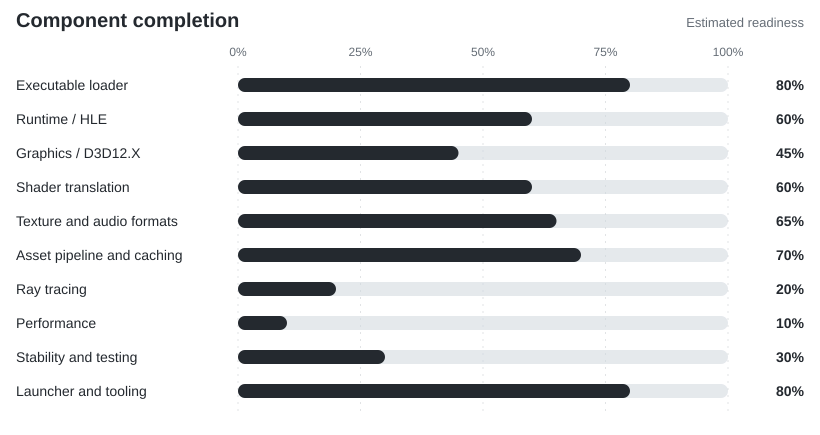

<p align="center">
  
</p>

<p align="center">
  <strong>Xbox Series compatibility layer for Windows</strong>
</p>

<p align="center">
  <a href="#status">Status</a> ·
  <a href="#getting-started">Getting started</a> ·
  <a href="#benchmarking">Benchmarking</a> ·
  <a href="#development">Development</a>
</p>

Comet is an open-source Xbox Series compatibility layer written in Rust. It runs Xbox Series code natively on Windows and translates console APIs and GPU shaders to their PC equivalents.

## Status

**Overall progress: ~50%**

| Component | Completion | Focus |
| :--- | ---: | :--- |
| Executable loader | 80% | Native execution and executable loading |
| Runtime / HLE | 60% | Partial console API support |
| Graphics / D3D12.X | 45% | Rendering and resource management |
| Shader translation | 60% | RDNA2 to DXIL translation |
| Texture and audio formats | 65% | Texture conversion, BCPack and audio |
| Asset pipeline and caching | 70% | Asset conversion and shader caching |
| Ray tracing | 20% | Experimental acceleration structure support |
| Performance | 10% | CPU and GPU optimization |
| Stability and testing | 30% | Crash fixes and automated testing |
| Launcher and tooling | 80% | Launcher, diagnostics and benchmarking |

<p align="center">
  
</p>

*Progress estimates toward a playable release, not compatibility or test coverage.*

### Current performance and milestones

| Milestone | Status |
| :--- | :--- |
| Native execution | Working |
| Gameplay | Working (experimental) |
| Gameplay FPS | ~1–3 FPS |
| Menu FPS | 30 FPS (stable) |
| Rendering accuracy | In development |
| Playable release | In development |

### Test hardware

All milestones and performance figures were tested on this system:

| Component | Specification |
| :--- | :--- |
| GPU | NVIDIA GeForce RTX 5070 Laptop GPU |
| CPU | Intel Core Ultra 9 275HX |
| RAM | 32 GB |
| OS | Windows 11 |

NVIDIA GPUs are the current focus. Other vendors are experimental.

[Open defects](https://github.com/Fyntra-Development/Comet/issues?q=is%3Aissue+is%3Aopen+label%3Adefect) · [Performance tracking](https://github.com/Fyntra-Development/Comet/issues/57) · [Development history](docs/independent-review.md)

## Getting started

### Requirements

| | Requirement |
| :--- | :--- |
| OS | 64-bit Windows 10 or 11 |
| CPU | AVX2 support |
| GPU | NVIDIA GeForce RTX 20 Series or newer; Direct3D 12, shader model 6.6 and mesh shaders |
| Memory | Several GB of available Windows commit memory |
| Build tools | [Pinned Rust toolchain](rust-toolchain.toml) and MSVC C++ build tools |

You will also need your own legally obtained Xbox Series title files. No game files are included with Comet.

### Build and launch

Run the following in PowerShell:

```powershell
git clone https://github.com/Fyntra-Development/Comet.git
cd Comet
cargo build --release -p comet --locked
.\target\release\comet.exe doctor
powershell -NoProfile -ExecutionPolicy Bypass -File .\scripts\launcher.ps1
```

The `doctor` command checks your GPU, VRAM and required CPU and GPU features. The launcher lets you select the executable, save location, shader cache and display mode.

Use an XInput controller or keyboard with the game window focused.

<details>
<summary>Launch from the command line</summary>

```powershell
$game = (Read-Host 'Full path to the Xbox Series executable').Trim('"')
powershell -NoProfile -ExecutionPolicy Bypass -File .\scripts\play.ps1 -Game $game
```

Use `-Cache` and `-Data` to override the default directories under `%LOCALAPPDATA%\comet`. To select a specific GPU, pass `-AdapterIndex` with the index reported by `doctor`.

</details>

### Display mode

The default virtual display mode is 4K at 60 Hz. Use `-DisplayMode 1920x1080@60` with the play script to report a 1080p display instead, or select a mode in the launcher.

Use `-DisplayMode Default` to restore the default. The title determines its internal rendering resolution and frame rate.

### Troubleshooting

| Problem | What to check |
| :--- | :--- |
| Windows error 1455 in `crashes.log` | Check the paging file and available commit memory. |
| GPU changed or not detected | Run `comet.exe doctor` again and check the adapter index. |
| Runtime error or crash | Check `comet.log` in the Windows temporary directory. Use `-RunLabel` to keep separate logs. |

<details>
<summary>Migrating from ZTRX</summary>

Use `comet.exe`, `comet.toml` and the `COMET_` environment variable prefix. Move saves to `%LOCALAPPDATA%\comet\data` or point to the existing directory with `-Data`. You may need to rebuild your shader cache.

</details>

## Benchmarking

Warm the shader cache before measuring. Keep the build, driver, display mode and test conditions fixed, and run each test for at least 100 seconds.

```powershell
$game = (Read-Host 'Full path to the Xbox Series executable').Trim('"')
powershell -NoProfile -ExecutionPolicy Bypass -File .\scripts\play.ps1 -Game $game -GpuProfile Baseline -Benchmark -RunLabel baseline
$baseline = Join-Path ([IO.Path]::GetTempPath()) 'comet-baseline.log'
.\scripts\summarize-benchmark.ps1 -Log $baseline -SkipSeconds 30 -MeasureSeconds 60
```

Exit normally to finish recording. For an A/B test, change one setting, use a different run label and compare the same measurement window. Report FPS, mean frame time, P95 (if available), correctness and stability. Collect GPU timing separately because it changes submission behavior.

See [benchmark comparison script](scripts/compare-benchmarks.ps1) and [previous validation runs](docs/independent-review.md).

<details>
<summary>GPU profiles and advanced tuning</summary>

| GPU profile | Description |
| :--- | :--- |
| `Baseline` | Synchronous submission; reference configuration |
| `Relay` | Experimental overlapping submission and copy-back |
| `LateWait` | Experimental late waits with wide copy-back |
| `WideReadback` | Parallel CPU snapshots and comparisons with synchronous GPU waits |

Select a profile using `-GpuProfile`.

Relay is experimental and disabled by default. Enable it with `COMET_RELAY=2`, or test the proposed default with `COMET_RELAY_DEFAULT=1` and the explicit Relay and late-wait settings unset. Set `COMET_RELAY=0` to override it.

| Setting | Options |
| :--- | :--- |
| `COMET_RELAY_SAFE` | `1` (default when Relay is enabled): wait for overlapping staging and shadow accesses; `2`: serialize flight landing; `0`: unsafe overlap for diagnostics |
| `-CardHash` | `Serial` or `Parallel` (default, with serial fallback) |
| `-CardMerge` | `Serial` or `Parallel` CPU merge |
| `-CardPlacement` | `Baseline` (16 MiB minimum) or `SmallBuffers` (1 MiB minimum); both use a 512 MiB cap and respect the local VRAM budget |

LateWait uses `COMET_RELAY=0`, `COMET_LATE_WAIT=3` and `COMET_WIDE_BACK=1`.

Other experimental settings:

- Texture scheduling: `COMET_HEAP_TEXTURE_BUDGET_MS=16`, `COMET_TEXTURE_SHORT_LOCK=1`, `COMET_WIDE_TEXTURES=1`.
- Page mapping: `COMET_BATCH_PAGE_ALIASES=1`, `COMET_REUSE_PAGE_ALIASES=1`.
- GPU-written data: `COMET_RETAIN_CARD_WRITES=1`.

Test these individually against the baseline. See the [development history](docs/independent-review.md) for implementation notes and measurements.

</details>

## Development

### Project layout

| Crate | Purpose |
| :--- | :--- |
| [comet-loader](crates/comet-loader) | Native executable loading |
| [comet-hle](crates/comet-hle) | Console runtime APIs |
| [comet-gpu](crates/comet-gpu) | D3D12.X to D3D12 translation |
| [comet-shader](crates/comet-shader) | GPU shader translation |
| [comet-formats](crates/comet-formats) | Texture layouts and audio formats |
| [comet-pipeline](crates/comet-pipeline) | Conversion and content-addressed caching |

### Build checks

```powershell
cargo xtask install-hooks
cargo xtask policy
cargo test --workspace --locked
cargo clippy --workspace --all-targets --locked -- -D warnings
```

<details>
<summary>Diagnostics build</summary>

```powershell
cargo build --profile diag -p comet --features diagnostics --locked
```

The diagnostics executable supports frame capture (`COMET_CAPTURE`, `COMET_CAPTURE_FRAMES`) and scripted input (`COMET_KEYS`). Run it directly when using these settings. Set `COMET_D3D12_DRED=1` to report commands in flight after a GPU failure.

</details>

### Documentation and contributions

- [Architecture](docs/architecture.md)
- [Ray tracing](docs/fork-ray-tracing.md)
- [Asset policy](docs/asset-policy.md)
- [Contribution and patch workflow](patches/README.md)

Development is coordinated through [GitHub Issues](https://github.com/Fyntra-Development/Comet/issues/44). Do not commit game files, extracted data, shader dumps or game screenshots.

## Credits and license

Comet is maintained by [Fyntra Development](https://github.com/Fyntra-Development). It is a fork of [ZTRX](https://github.com/Zettrox/ztrx), based on VIctory by Marvisak and victory-fork by fxceless. Original authorship and license notices are retained.

Comet is independent of the title's developer and publisher.

Licensed under [GPL-3.0-or-later](LICENSE). The BCPack format-table exception is documented in the [asset policy](docs/asset-policy.md).

[Lucide](https://lucide.dev) icons are used under the [ISC and Feather MIT licenses](docs/icons/LICENSE).
